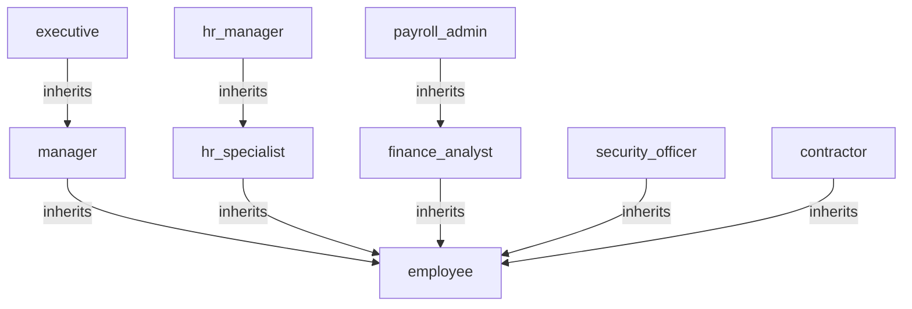

# Northstar Health — Speedle policy model

| Field | Value |
| --- | --- |
| Source document | `handbook.md` (synthetic, version 3.2) |
| Service name | `northstar_hr` |
| Model status | Reviewed for the example run |
| Generated | 2026-11-06 |
| SPDL file | `policies.spdl` |
| Tests | `test-cases.json` |
| Validation results | `results.md` |

## 1. Scope

This model covers access to the `northstar_hr` application for Northstar Health employees,
contractors and the `payroll_sync` service account. It covers reads of employee records,
salary data, the handbook, the directory, Public and Internal data, department and executive
reports, audit logs and payroll runs, plus updates to employee records and salary data and
approvals of expenses.

Out of scope: other applications, production infrastructure, physical premises, the quarterly
access review (9.3) and the written-exception process (9.2). Those are process controls; they
are not encoded as SPDL rules.

## 2. Source inventory

| Clause | Requirement (short) | Kind | Disposition |
| --- | --- | --- | --- |
| 1.1 | Handbook covers people, finance and security systems for employees, contractors and service accounts | scope | This model |
| 1.2 | Applies to `northstar_hr` only | scope | Service `northstar_hr` |
| 1.3 | Legal requirement wins; exceptions in section 9 | scope | Documented; 9.2 out of scope |
| 2.1 | Five departments | organization | Resource prefixes and role scopes |
| 2.2 | Job levels L1–L6 | organization | Context only; no policy uses level |
| 2.3 | London, Berlin, New York | organization | `location` and `requester_location` attributes |
| 2.4 | Employees in `all_staff`; contractors in `contractors` | identity | Group principals in role assignments |
| 3.1 | Every employee has `employee` | role assignment | R09 |
| 3.2 | HR staff have `hr_specialist`; HR lead has `hr_manager` | role assignment | R10, R11; R03 |
| 3.3 | Finance staff have `finance_analyst`; payroll team has `payroll_admin` | role assignment | R12, R13 |
| 3.4 | Security staff have `security_officer` | role assignment | R14 |
| 3.5 | Engineering manager has `manager` for Engineering only | role assignment | R17 |
| 3.6 | CEO and direct reports have `executive` | role assignment | R15 |
| 3.7 | Contractors have `contractor` | role assignment | R16 |
| 3.8 | Role hierarchy | inheritance | R01–R08 |
| 4.1 | Four data classes | data classification | `classification` attribute and resource namespaces |
| 4.2 | Employees read Public and Internal data | authorization | P09, P10 |
| 4.3 | Contractors may not read Internal Confidential data | exception | P11 (deny) |
| 4.4 | HR specialists read records at their own location, not Restricted | authorization | P04 |
| 4.5 | HR managers read all records; update non-Restricted; read salary | authorization | P05, P06, P07 |
| 4.6 | Payroll administrators read and update salary | authorization | P08 |
| 4.7 | Salary is a separate resource | resource model | `/hr/salary/<id>` |
| 5.1 | Employees read their own record only | authorization | P03 |
| 5.2 | Directory available to all employees | authorization | P02 |
| 5.3 | Handbook available to all employees | authorization | P01 |
| 6.1 | Manager approves up to and including 5,000 in own department | authorization | P12 |
| 6.2 | Finance approves 5,000.01–25,000 inclusive | authorization | P13 |
| 6.3 | Executive approves above 25,000 | authorization | P14 |
| 6.4 | Manager authority is department-scoped; finance and executive are company-wide | scope | R17; P13, P14 |
| 7.1 | Finance analysts read department reports | authorization | P15 |
| 7.2 | Executives read executive reports | authorization | P16 |
| 7.3 | Security officers read audit logs | authorization | P17 |
| 8.1 | `payroll_sync` reads and updates payroll runs; no human | authorization | P18 |
| 9.1 | Explicit deny overrides grant | decision rule | P11; evaluator semantics |
| 9.2 | Written exceptions, time-limited | process | Out of scope; noted |
| 9.3 | Quarterly access review | process | Out of scope; noted |
| 10.1–10.6 | Acceptance examples | tests | T01–T37 |

## 3. Organization and identity model

### 3.1 Principals

| Principal | Type | Source | Used for |
| --- | --- | --- | --- |
| `alice` | user | HR lead | `hr_manager` assignment |
| `bob` | user | HR specialist | reaches `hr_specialist` through `group hr` |
| `carol` | user | Engineering manager | scoped `manager` assignment |
| `dave` | user | Engineer | `employee` through `group all_staff` |
| `erin` | user | Finance analyst | `finance_analyst` through `group finance` |
| `frank` | user | Payroll administrator | `payroll_admin` assignment |
| `grace` | user | Executive | `executive` assignment |
| `heidi` | user | Contractor | `contractor` through `group contractors` |
| `ivan` | user | Security officer | `security_officer` through `group security` |
| `all_staff` | group | Identity provider | base employee cohort |
| `hr` | group | Identity provider | HR specialist cohort |
| `finance` | group | Identity provider | finance analyst cohort |
| `security` | group | Identity provider | security officer cohort |
| `contractors` | group | Identity provider | contractor cohort |
| `payroll_sync` | entity | Service account | payroll run automation |

The request subject carries the user principal and the IdP groups the user belongs to. If a
group is not sent, the corresponding role policy does not match; the model does not fall back
to a user assignment for that cohort.

### 3.2 Organization facts

| Fact | Value | Source |
| --- | --- | --- |
| Departments | People Operations, Finance, Engineering, Security, Executive Office | 2.1 |
| Job levels | L1–L6; L4 manager, L5 senior manager, L6 executive | 2.2 |
| Locations | London, Berlin, New York | 2.3 |
| Data classes | Public, Internal, Confidential, Restricted | 4.1 |

Job level is not used by any policy. It is recorded here because the handbook defines it and
a future rule might use it; no attribute is sent for it.

## 4. Role model

### 4.1 Role catalog

| Role | Purpose | Assigned to | Scope | Inherits | Source |
| --- | --- | --- | --- | --- | --- |
| `employee` | Base staff reads | `group all_staff`; inherited by several roles | service | — | 3.1 |
| `manager` | Department expense approval | `user carol`, scoped to Engineering; inherited by `executive` | Engineering for carol | `employee` | 3.5, 3.8, 6.1 |
| `hr_specialist` | HR record reads at own location | `group hr` | service | `employee` | 3.2, 3.8, 4.4 |
| `hr_manager` | HR record reads and updates, salary reads | `user alice` | service | `hr_specialist` | 3.2, 3.8, 4.5 |
| `finance_analyst` | Finance report reads and mid-range approvals | `group finance` | service | `employee` | 3.3, 3.8, 6.2, 7.1 |
| `payroll_admin` | Salary reads and updates | `user frank` | service | `finance_analyst` | 3.3, 3.8, 4.6 |
| `security_officer` | Audit log reads | `group security` | service | `employee` | 3.4, 3.8, 7.3 |
| `executive` | Executive reports and high-value approvals | `user grace` | service | `manager` | 3.6, 3.8, 6.3, 7.2 |
| `contractor` | Contractor access with the 4.3 exception | `group contractors` | service | `employee` | 3.7, 3.8, 4.3 |

### 4.2 Role inheritance



The arrows point from the child role to the role it includes. `executive` reaches `employee`
through `manager`; `hr_manager` reaches `employee` through `hr_specialist`; `payroll_admin`
reaches `employee` through `finance_analyst`.

### 4.3 Role assignment rules

| Rule | Principal | Role | Scope | Source | SPDL |
| --- | --- | --- | --- | --- | --- |
| R01 | `role manager` | `employee` | service | 3.8 | `grant role manager role employee` |
| R02 | `role hr_specialist` | `employee` | service | 3.8 | `grant role hr_specialist role employee` |
| R03 | `role hr_manager` | `hr_specialist` | service | 3.8 | `grant role hr_manager role hr_specialist` |
| R04 | `role finance_analyst` | `employee` | service | 3.8 | `grant role finance_analyst role employee` |
| R05 | `role payroll_admin` | `finance_analyst` | service | 3.8 | `grant role payroll_admin role finance_analyst` |
| R06 | `role security_officer` | `employee` | service | 3.8 | `grant role security_officer role employee` |
| R07 | `role executive` | `manager` | service | 3.8 | `grant role executive role manager` |
| R08 | `role contractor` | `employee` | service | 3.8 | `grant role contractor role employee` |
| R09 | `group all_staff` | `employee` | service | 2.4, 3.1 | `grant group all_staff role employee` |
| R10 | `group hr` | `hr_specialist` | service | 3.2 | `grant group hr role hr_specialist` |
| R11 | `user alice` | `hr_manager` | service | 3.2 | `grant user alice role hr_manager` |
| R12 | `group finance` | `finance_analyst` | service | 3.3 | `grant group finance role finance_analyst` |
| R13 | `user frank` | `payroll_admin` | service | 3.3 | `grant user frank role payroll_admin` |
| R14 | `group security` | `security_officer` | service | 3.4 | `grant group security role security_officer` |
| R15 | `user grace` | `executive` | service | 3.6 | `grant user grace role executive` |
| R16 | `group contractors` | `contractor` | service | 3.7 | `grant group contractors role contractor` |
| R17 | `user carol` | `manager` | `expr:^/expenses/engineering/.*$` | 3.5, 6.4 | `grant user carol role manager on expr:^/expenses/engineering/.*$` |

R17 is the only resource-scoped role. It gives Carol the manager role only while the request
resource is an Engineering expense. The manager permission policy (P12) is not scoped, so the
role assignment is what limits her to Engineering.

## 5. Resource and action model

### 5.1 Resources

| Resource / pattern | Kind | Actions | Sensitivity | Source |
| --- | --- | --- | --- | --- |
| `/hr/handbook` | exact | read | Internal | 5.3 |
| `/hr/directory` | exact | read | Internal | 5.2 |
| `/hr/employees/<id>` | `expr:^/hr/employees/.*$` | read, update | Internal / Restricted | 4.4, 4.5, 5.1 |
| `/hr/salary/<id>` | `expr:^/hr/salary/.*$` | read, update | Restricted | 4.5, 4.6, 4.7 |
| `/data/public/<path>` | `expr:^/data/public/.*$` | read | Public | 4.2 |
| `/data/internal/<path>` | `expr:^/data/internal/.*$` | read | Internal | 4.2 |
| `/data/internal/confidential/<path>` | `expr:^/data/internal/confidential/.*$` | read | Confidential | 4.3 |
| `/expenses/<department>/<id>` | `expr:^/expenses/.*$` | approve | Internal | 6.1–6.4 |
| `/finance/reports/department/<id>` | `expr:^/finance/reports/department/.*$` | read | Confidential | 7.1 |
| `/finance/reports/executive/<id>` | `expr:^/finance/reports/executive/.*$` | read | Restricted | 7.2 |
| `/security/audit/<id>` | `expr:^/security/audit/.*$` | read | Restricted | 7.3 |
| `/hr/payroll/<id>` | `expr:^/hr/payroll/.*$` | read, update | Restricted | 8.1 |

Salary is deliberately its own namespace. The nested form `/hr/employees/<id>/salary` would
be a general regex (`.*` is not at the end); `/hr/salary/<id>` is a prefix expression, so the
evaluator can index it in the prefix radix tree. Every resource expression in this model is a
prefix expression; there is no general regex and no `expr:^.*$`.

### 5.2 Actions

| Action | Meaning | Notes |
| --- | --- | --- |
| `read` | view a resource | does not include update or export |
| `update` | change a resource | does not include create or delete |
| `approve` | approve an expense | the application still records the approval workflow |

`create`, `delete` and `export` are out of scope. If the application adds them, add explicit
policies and tests; do not assume `read` covers them.

## 6. Attributes and conditions

| Attribute | Type | Supplied by | Trust boundary | Used by |
| --- | --- | --- | --- | --- |
| `owner` | string | HR system, derived from the employee record | must not be taken from the request body | P03 |
| `location` | string | HR system, record metadata | must not be caller-controlled | P04 |
| `requester_location` | string | identity provider | trusted | P04 |
| `classification` | string | record metadata | must not be caller-controlled | P04, P06 |
| `amount` | numeric | expense system of record | must not be caller-controlled | P12, P13, P14 |

### 6.1 Missing attributes

The PEP must send `owner` for P03, `location` and `requester_location` and `classification`
for P04, `classification` for P06, and `amount` for P12–P14. If an attribute is missing,
Speedle treats the condition as non-matching and the policy silently contributes no grant.
The PEP should reject a request that lacks an attribute required by the action before calling
ADS; a silent denial is the fallback, not the design.

### 6.2 Time and level

No policy uses `request_time` or the job level. The handbook does not state a time-based or
level-based rule, so adding one would be an invention. Future time rules should use
`request_year`, `request_month`, `request_day`, `request_hour` or `request_weekday` rather
than `request_time`, and must document the server's time zone.

## 7. Policies

### P01 — Employee reads the handbook

```spdl
grant role employee read /hr/handbook
```

| Field | Value |
| --- | --- |
| Effect | grant |
| Principals | `role employee` |
| Actions | `read` |
| Resource | `/hr/handbook` (exact) |
| Condition | none |
| Implements | 3.1, 5.3 |
| Evaluation index | exact resource hash map |
| Tests | T01, T29, T30 |

**Rationale.** The handbook is available to every employee (5.3) and every employee has the
employee role (3.1). Contractors inherit employee (3.8), so they read it too; P11 only denies
confidential data.

### P02 — Employee reads the directory

```spdl
grant role employee read /hr/directory
```

| Field | Value |
| --- | --- |
| Effect | grant |
| Principals | `role employee` |
| Actions | `read` |
| Resource | `/hr/directory` (exact) |
| Condition | none |
| Implements | 5.2 |
| Evaluation index | exact resource hash map |
| Tests | T37 |

**Rationale.** 5.2 makes the directory available to all employees. This is intentionally
broader than 5.1 (own record only) because the handbook distinguishes the directory from the
employee record.

### P03 — Employee reads their own record

```spdl
grant role employee read expr:^/hr/employees/.*$ if owner == request_user
```

| Field | Value |
| --- | --- |
| Effect | grant |
| Principals | `role employee` |
| Actions | `read` |
| Resource | `/hr/employees/...` (prefix) |
| Condition | `owner == request_user` |
| Required attributes | `owner` |
| Implements | 5.1 |
| Evaluation index | prefix radix tree; condition evaluated only for this candidate |
| Tests | T02, T03 |

**Rationale.** 5.1 gives every employee their own record, not every record. The `owner`
attribute comes from the record, so the condition is an ABAC check on data the caller cannot
choose. The prefix expression covers all employee records; the condition narrows the grant.

### P04 — HR specialist reads a non-restricted record at their own location

```spdl
grant role hr_specialist read expr:^/hr/employees/.*$ if location == requester_location && classification != 'restricted'
```

| Field | Value |
| --- | --- |
| Effect | grant |
| Principals | `role hr_specialist` |
| Actions | `read` |
| Resource | `/hr/employees/...` (prefix) |
| Condition | `location == requester_location && classification != 'restricted'` |
| Required attributes | `location`, `requester_location`, `classification` |
| Implements | 4.4 |
| Evaluation index | prefix radix tree |
| Tests | T04, T05, T27 |

**Rationale.** 4.4 has two independent limits: same location and not Restricted. Both must
hold, so they are joined with `&&`. The condition runs only for HR specialists reading an
employee record; the principal and resource indexes have already narrowed the candidate set.

### P05 — HR manager reads every employee record

```spdl
grant role hr_manager read expr:^/hr/employees/.*$
```

| Field | Value |
| --- | --- |
| Effect | grant |
| Principals | `role hr_manager` |
| Actions | `read` |
| Resource | `/hr/employees/...` (prefix) |
| Condition | none |
| Implements | 4.5 |
| Evaluation index | prefix radix tree |
| Tests | T26 |

**Rationale.** 4.5 gives HR managers all employee records, including Restricted. The role is
assigned to Alice, so the grant is narrow by principal rather than by a classification
condition. This is deliberately different from P04.

### P06 — HR manager updates a non-restricted record

```spdl
grant role hr_manager update expr:^/hr/employees/.*$ if classification != 'restricted'
```

| Field | Value |
| --- | --- |
| Effect | grant |
| Principals | `role hr_manager` |
| Actions | `update` |
| Resource | `/hr/employees/...` (prefix) |
| Condition | `classification != 'restricted'` |
| Required attributes | `classification` |
| Implements | 4.5 |
| Evaluation index | prefix radix tree |
| Tests | T08, T09 |

**Rationale.** 4.5 grants update only for non-Restricted records. The condition is on the
same resource family as P05 but on a different action, so the two grants split cleanly:
read all, update non-restricted.

### P07 — HR manager reads salary data

```spdl
grant role hr_manager read expr:^/hr/salary/.*$
```

| Field | Value |
| --- | --- |
| Effect | grant |
| Principals | `role hr_manager` |
| Actions | `read` |
| Resource | `/hr/salary/...` (prefix) |
| Condition | none |
| Implements | 4.5, 4.7 |
| Evaluation index | prefix radix tree |
| Tests | T07 |

**Rationale.** 4.5 grants salary reads to HR managers. Salary is a separate resource (4.7),
so this grant does not accidentally cover the employee record or vice versa.

### P08 — Payroll administrator reads and updates salary data

```spdl
grant role payroll_admin read,update expr:^/hr/salary/.*$
```

| Field | Value |
| --- | --- |
| Effect | grant |
| Principals | `role payroll_admin` |
| Actions | `read`, `update` |
| Resource | `/hr/salary/...` (prefix) |
| Condition | none |
| Implements | 4.6 |
| Evaluation index | prefix radix tree |
| Tests | T10 |

**Rationale.** 4.6 gives payroll administrators both read and update on salary. The
`payroll_admin` role inherits `finance_analyst` and `employee`, but those roles do not get
salary access through inheritance; the salary grant is on `payroll_admin` itself.

### P09 — Employee reads Public data

```spdl
grant role employee read expr:^/data/public/.*$
```

| Field | Value |
| --- | --- |
| Effect | grant |
| Principals | `role employee` |
| Actions | `read` |
| Resource | `/data/public/...` (prefix) |
| Condition | none |
| Implements | 4.2 |
| Evaluation index | prefix radix tree |
| Tests | T31, T32 |

**Rationale.** 4.2 grants Public data to employees. Contractors inherit employee and read it
too, which is consistent with 4.3 (the contractor restriction is only on Internal
Confidential).

### P10 — Employee reads Internal data

```spdl
grant role employee read expr:^/data/internal/.*$
```

| Field | Value |
| --- | --- |
| Effect | grant |
| Principals | `role employee` |
| Actions | `read` |
| Resource | `/data/internal/...` (prefix) |
| Condition | none |
| Implements | 4.2 |
| Evaluation index | prefix radix tree |
| Tests | T21 |

**Rationale.** 4.2 grants Internal data to employees. The contractor exception is a separate
deny (P11), not a condition here; this keeps the grant readable and makes the exception
visible.

### P11 — Contractors may not read Internal Confidential data

```spdl
deny role contractor read expr:^/data/internal/confidential/.*$
```

| Field | Value |
| --- | --- |
| Effect | deny |
| Principals | `role contractor` |
| Actions | `read` |
| Resource | `/data/internal/confidential/...` (prefix) |
| Condition | none |
| Implements | 4.3, 9.1 |
| Evaluation index | prefix radix tree |
| Tests | T20 |

**Rationale.** Contractors inherit the employee grant in P10, so a deny is required to
remove the Confidential subset. The deny is narrower than the grant (one sub-prefix) and
overrides it. A request from a contractor returns reason 1 (deny found), not reason 3 (no
applicable policy); that distinction matters in the audit trail.

### P12 — Department manager approves up to 5,000

```spdl
grant role manager approve expr:^/expenses/.*$ if amount <= 5000
```

| Field | Value |
| --- | --- |
| Effect | grant |
| Principals | `role manager` |
| Actions | `approve` |
| Resource | `/expenses/...` (prefix) |
| Condition | `amount <= 5000` |
| Required attributes | `amount` |
| Implements | 6.1, 6.4 |
| Evaluation index | prefix radix tree |
| Tests | T14, T16, T33, T34 |

**Rationale.** 6.1 sets an inclusive upper bound. The department limit is enforced by the
scoped role assignment R17, not by this policy: Carol only has the manager role while the
resource is under `/expenses/engineering/`. This keeps one permission policy for all
departments.

### P13 — Finance analyst approves 5,000.01 through 25,000

```spdl
grant role finance_analyst approve expr:^/expenses/.*$ if amount > 5000 && amount <= 25000
```

| Field | Value |
| --- | --- |
| Effect | grant |
| Principals | `role finance_analyst` |
| Actions | `approve` |
| Resource | `/expenses/...` (prefix) |
| Condition | `amount > 5000 && amount <= 25000` |
| Required attributes | `amount` |
| Implements | 6.2, 6.4 |
| Evaluation index | prefix radix tree |
| Tests | T17, T18, T35, T36 |

**Rationale.** 6.2 covers the range above the manager limit through 25,000. The lower bound
is strict and the upper bound is inclusive, so there is no gap or overlap with P12 and P14.
Finance authority is company-wide (6.4), so the role is not scoped.

### P14 — Executive approves above 25,000

```spdl
grant role executive approve expr:^/expenses/.*$ if amount > 25000
```

| Field | Value |
| --- | --- |
| Effect | grant |
| Principals | `role executive` |
| Actions | `approve` |
| Resource | `/expenses/...` (prefix) |
| Condition | `amount > 25000` |
| Required attributes | `amount` |
| Implements | 6.3, 6.4 |
| Evaluation index | prefix radix tree |
| Tests | T19 |

**Rationale.** 6.3 is the top tier. The executive role inherits manager, so an executive also
matches P12 for amounts up to 5,000; that is intended, because an executive has at least the
manager's authority. The condition prevents double-counting above 25,000.

### P15 — Finance analyst reads department reports

```spdl
grant role finance_analyst read expr:^/finance/reports/department/.*$
```

| Field | Value |
| --- | --- |
| Effect | grant |
| Principals | `role finance_analyst` |
| Actions | `read` |
| Resource | `/finance/reports/department/...` (prefix) |
| Condition | none |
| Implements | 7.1 |
| Evaluation index | prefix radix tree |
| Tests | T11, T12 |

**Rationale.** 7.1 grants department reports only. The separate prefix keeps executive
reports out of the finance analyst's candidate set; T12 proves the denial.

### P16 — Executive reads executive reports

```spdl
grant role executive read expr:^/finance/reports/executive/.*$
```

| Field | Value |
| --- | --- |
| Effect | grant |
| Principals | `role executive` |
| Actions | `read` |
| Resource | `/finance/reports/executive/...` (prefix) |
| Condition | none |
| Implements | 7.2 |
| Evaluation index | prefix radix tree |
| Tests | T13 |

**Rationale.** 7.2 is limited to executives. The executive role also inherits manager and
employee, but neither parent has a finance-report grant, so this policy is the only path.

### P17 — Security officer reads audit logs

```spdl
grant role security_officer read expr:^/security/audit/.*$
```

| Field | Value |
| --- | --- |
| Effect | grant |
| Principals | `role security_officer` |
| Actions | `read` |
| Resource | `/security/audit/...` (prefix) |
| Condition | none |
| Implements | 7.3 |
| Evaluation index | prefix radix tree |
| Tests | T22, T23 |

**Rationale.** 7.3 grants audit logs to security officers. The role inherits employee, so the
security officer also has the ordinary employee reads; T23 confirms that inheritance does not
extend to salary.

### P18 — Payroll sync service account

```spdl
grant entity payroll_sync read,update expr:^/hr/payroll/.*$
```

| Field | Value |
| --- | --- |
| Effect | grant |
| Principals | `entity payroll_sync` |
| Actions | `read`, `update` |
| Resource | `/hr/payroll/...` (prefix) |
| Condition | none |
| Implements | 8.1 |
| Evaluation index | prefix radix tree |
| Tests | T24, T25 |

**Rationale.** 8.1 is a service-account grant, not a human role. Modeling it as an `entity`
principal keeps the human and machine paths separate: no human role contains this grant, and
T25 confirms an employee cannot read payroll runs.

## 8. Explicit denies and exceptions

| Deny | Statement | Overrides | Why it is narrower | Source | Tests |
| --- | --- | --- | --- | --- | --- |
| D01 / P11 | `deny role contractor read expr:^/data/internal/confidential/.*$` | P10 | One sub-prefix of Internal data, one action, one role | 4.3, 9.1 | T20 |

There are no deny role policies in this model. The deny is an authorization policy, so it is
easy to review: it removes the Confidential subset from contractors without touching the
contractor role's inheritance or the employee grant. The written-exception process (9.2) and
the quarterly review (9.3) are out of scope; they are not encoded as grants.

## 9. Evaluation-efficiency summary

| Metric | Value |
| --- | --- |
| Services | 1 |
| Authorization policies | 18 |
| Role policies | 17 |
| Exact-resource policies | 2 (`/hr/handbook`, `/hr/directory`) |
| Prefix-resource policies | 16 |
| General-regex policies | 0 |
| Catch-all policies (`expr:^.*$` or `everyone_role`) | 0 |
| Policies with conditions | 6 (P03, P04, P06, P12, P13, P14) |

Every resource expression is a prefix expression (`^.../.*$`), so the evaluator indexes it in
the prefix radix tree; the two exact resources are hash-map lookups. No request scans a
general regex or evaluates a condition on every resource. Conditions sit only on policies
already narrowed by role and resource, so they run for a small candidate set.

The 17 role policies are all unscoped except R17 (Engineering expenses). Role resolution
walks the inheritance graph to a fixed point on every request; the graph is shallow (at most
two edges to `employee`) and acyclic.

## 10. Test cases

The full request bodies are in `test-cases.json`. Reason codes: 0 grant, 1 deny, 2 service
not found, 3 no applicable policy, 4 evaluation error.

| ID | Clause | Scenario | Expected | Reason |
| --- | --- | --- | --- | --- |
| T01 | 3.1, 5.3 | Employee reads the handbook | allow | 0 |
| T02 | 5.1 | Employee reads their own record | allow | 0 |
| T03 | 5.1 | Employee reads another employee's record | deny | 3 |
| T04 | 4.4 | HR specialist reads a non-restricted record at their location | allow | 0 |
| T05 | 4.4 | HR specialist reads a record at another location | deny | 3 |
| T06 | 4.5, 4.6 | HR specialist reads salary | deny | 3 |
| T07 | 4.5 | HR manager reads salary | allow | 0 |
| T08 | 4.5 | HR manager updates a non-restricted record | allow | 0 |
| T09 | 4.5 | HR manager updates a restricted record | deny | 3 |
| T10 | 4.6 | Payroll administrator updates salary | allow | 0 |
| T11 | 7.1 | Finance analyst reads a department report | allow | 0 |
| T12 | 7.2 | Finance analyst reads an executive report | deny | 3 |
| T13 | 3.6, 7.2 | Executive reads an executive report | allow | 0 |
| T14 | 6.1, 6.4 | Manager approves 4,000 in Engineering | allow | 0 |
| T15 | 6.4 | Manager approves 4,000 in Sales | deny | 3 |
| T16 | 6.1 | Manager approves 6,000 in Engineering | deny | 3 |
| T17 | 6.2 | Finance analyst approves 6,000 | allow | 0 |
| T18 | 6.2 | Finance analyst approves 30,000 | deny | 3 |
| T19 | 6.3 | Executive approves 30,000 | allow | 0 |
| T20 | 4.3, 9.1 | Contractor reads Internal Confidential data | deny | 1 |
| T21 | 4.2 | Employee reads Internal Confidential data | allow | 0 |
| T22 | 7.3 | Security officer reads audit logs | allow | 0 |
| T23 | 3.4, 4.5 | Security officer reads salary | deny | 3 |
| T24 | 8.1 | Payroll sync entity reads a payroll run | allow | 0 |
| T25 | 8.1 | Employee reads a payroll run | deny | 3 |
| T26 | 4.5 | HR manager reads a record with no classification condition | allow | 0 |
| T27 | 4.4 | HR specialist reads a restricted record | deny | 3 |
| T28 | 3.6, 3.8 | Executive inherits manager and employee | allow | 0 |
| T29 | 3.7, 4.3 | Contractor reads the handbook | allow | 0 |
| T30 | 3.1, 5.3 | Another employee reads the handbook | allow | 0 |
| T31 | 4.2 | Employee reads Public data | allow | 0 |
| T32 | 4.3 | Contractor reads Public data | allow | 0 |
| T33 | 6.1 | Manager limit includes 5,000 | allow | 0 |
| T34 | 6.1 | Manager cannot approve 5,000.01 | deny | 3 |
| T35 | 6.2 | Finance limit includes 25,000 | allow | 0 |
| T36 | 6.2 | Finance cannot approve 25,000.01 | deny | 3 |
| T37 | 5.2 | Employee reads the directory | allow | 0 |

`results.md` records the actual PASS/FAIL output of all 37 cases.

## 11. Clarifications and open questions

The full question-and-answer record is in `clarifications.md`. The decisions that changed the
model:

| ID | Decision | Effect |
| --- | --- | --- |
| Q1 | "At their own location" compares the record `location` with `requester_location` | P04 and T04/T05 |
| Q2 | The approval boundary is `<= 5000` / `> 5000 && <= 25000` | P12–P14, T33–T36 |
| Q3 | `payroll_sync` is an `entity`, not a shared human login | P18, T24/T25 |
| Q4 | The contractor exception is only the Internal Confidential subset | P11, T20 |
| Q5 | Missing attributes are a PEP error; a silent denial is only the fallback | P03, P04, P06, P12–P14 |

No open questions remain for this example. The process controls in 9.2 and 9.3 are
intentionally out of scope.

## 12. Import and operation

```bash
# Validate the SPDL and its conditions without a server
spctl check -f policies.spdl

# Load the same file into a local PMS and ADS and run every case
../../scripts/validate-model.sh policies.spdl test-cases.json
```

`validate-model.sh` starts PMS and ADS on free loopback ports and stops both when it exits.
If the binaries are not on `PATH`, pass `--spctl`, `--pms` and `--ads`. On macOS,
`/usr/sbin/spctl` is not Speedle's CLI; use the Speedle `bin/spctl`.

The target is the self-hosted `.spdl` file store. That file is a read-only import path:
PMS rewrites a managed store as JSON, so do not run `spctl create` or `spctl delete` against
`policies.spdl`. Edit the file and restart or reload PMS and ADS. If runtime management is
required, use a JSON, etcd, MySQL or MongoDB store instead and keep this SPDL as the reviewed
source.

## 13. Change log

| Date | Change | Author |
| --- | --- | --- |
| 2026-11-06 | Initial model for the English synthetic handbook | speedle-policy-modeler example |
