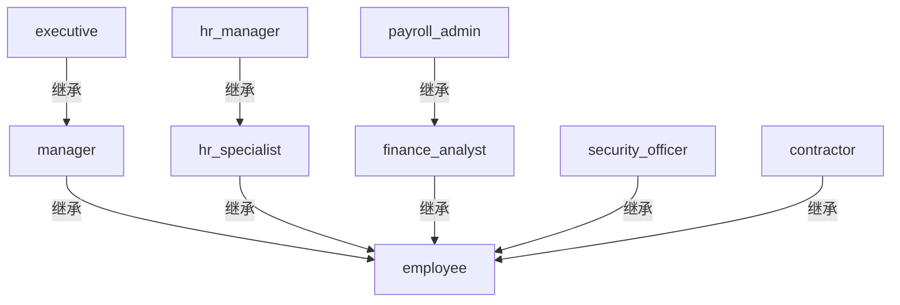

# Northstar Health — Speedle 策略模型

| 项目 | 内容 |
| --- | --- |
| 来源文档 | `handbook.md`（合成，版本 3.2） |
| 服务名 | `northstar_hr` |
| 模型状态 | 示例运行已复核 |
| 生成日期 | 2026-11-06 |
| SPDL 文件 | `policies.spdl` |
| 测试文件 | `test-cases.json` |
| 验证结果 | `results.md` |

## 1. 范围

本模型覆盖 `northstar_hr` 应用的访问控制，适用对象为 Northstar Health 的员工、外包人员和
`payroll_sync` 服务账号。覆盖的资源包括员工档案、薪资数据、员工手册、通讯录、公开和内部
数据、部门与高管财务报告、审计日志和薪资批次；覆盖的动作包括读取、更新和支出审批。

范围外：其他应用、生产基础设施、办公场所、9.3 的季度访问复核和 9.2 的书面例外流程。
后两项是流程控制，不编码为 SPDL 规则。

## 2. 来源条款清单

| 条款 | 要求（摘要） | 类型 | 处理方式 |
| --- | --- | --- | --- |
| 1.1 | 手册覆盖人员、财务和安全系统，适用员工、外包人员和服务账号 | 范围 | 本模型 |
| 1.2 | 只适用于 `northstar_hr` | 范围 | 服务 `northstar_hr` |
| 1.3 | 法律要求优先；例外按第 9 节 | 范围 | 记录；9.2 范围外 |
| 2.1 | 五个部门 | 组织 | 资源前缀和角色范围 |
| 2.2 | 职级 L1–L6 | 组织 | 仅记录，策略未使用职级 |
| 2.3 | London、Berlin、New York | 组织 | `location`、`requester_location` 属性 |
| 2.4 | 员工属于 `all_staff`；外包人员属于 `contractors` | 身份 | 角色分配中的组主体 |
| 3.1 | 每位员工都有 `employee` | 角色分配 | R09 |
| 3.2 | HR 员工有 `hr_specialist`；HR 负责人有 `hr_manager` | 角色分配 | R10、R11；R03 |
| 3.3 | 财务员工有 `finance_analyst`；薪资团队有 `payroll_admin` | 角色分配 | R12、R13 |
| 3.4 | 安全员工有 `security_officer` | 角色分配 | R14 |
| 3.5 | 工程经理只在工程部门有 `manager` | 角色分配 | R17 |
| 3.6 | CEO 和直接汇报的高管有 `executive` | 角色分配 | R15 |
| 3.7 | 外包人员有 `contractor` | 角色分配 | R16 |
| 3.8 | 角色继承关系 | 继承 | R01–R08 |
| 4.1 | 四个数据级别 | 数据分级 | `classification` 属性和资源命名空间 |
| 4.2 | 员工读取公开和内部数据 | 授权 | P09、P10 |
| 4.3 | 外包人员不得读取内部机密数据 | 例外 | P11（拒绝） |
| 4.4 | HR 专员读取本工作地点、非受限的档案 | 授权 | P04 |
| 4.5 | HR 经理读取全部档案、更新非受限档案、读取薪资 | 授权 | P05、P06、P07 |
| 4.6 | 薪资管理员读取和更新薪资 | 授权 | P08 |
| 4.7 | 薪资是独立资源 | 资源模型 | `/hr/salary/<id>` |
| 5.1 | 员工只读取自己的档案 | 授权 | P03 |
| 5.2 | 通讯录对所有员工开放 | 授权 | P02 |
| 5.3 | 手册对所有员工开放 | 授权 | P01 |
| 6.1 | 经理审批本部门不超过 5,000 的支出 | 授权 | P12 |
| 6.2 | 财务审批 5,000.01–25,000 | 授权 | P13 |
| 6.3 | 高管审批超过 25,000 的支出 | 授权 | P14 |
| 6.4 | 经理权限限本部门；财务和高管适用全公司 | 范围 | R17；P13、P14 |
| 7.1 | 财务分析师读取部门报告 | 授权 | P15 |
| 7.2 | 高管读取高管报告 | 授权 | P16 |
| 7.3 | 安全专员读取审计日志 | 授权 | P17 |
| 8.1 | `payroll_sync` 读取和更新薪资批次；人类员工不得访问 | 授权 | P18 |
| 9.1 | 明确拒绝优先于授予 | 决策规则 | P11；评估器语义 |
| 9.2 | 书面例外、设置有效期 | 流程 | 范围外，已记录 |
| 9.3 | 季度访问复核 | 流程 | 范围外，已记录 |
| 10.1–10.6 | 验收示例 | 测试 | T01–T37 |

## 3. 组织与身份模型

### 3.1 主体

| 主体 | 类型 | 来源 | 用途 |
| --- | --- | --- | --- |
| `alice` | user | HR 负责人 | 分配 `hr_manager` |
| `bob` | user | HR 专员 | 通过 `group hr` 获得 `hr_specialist` |
| `carol` | user | 工程经理 | 范围受限的 `manager` 分配 |
| `dave` | user | 工程师 | 通过 `group all_staff` 获得 `employee` |
| `erin` | user | 财务分析师 | 通过 `group finance` 获得 `finance_analyst` |
| `frank` | user | 薪资管理员 | 分配 `payroll_admin` |
| `grace` | user | 高管 | 分配 `executive` |
| `heidi` | user | 外包人员 | 通过 `group contractors` 获得 `contractor` |
| `ivan` | user | 安全专员 | 通过 `group security` 获得 `security_officer` |
| `all_staff` | group | 身份提供方 | 员工基础组 |
| `hr` | group | 身份提供方 | HR 专员组 |
| `finance` | group | 身份提供方 | 财务分析师组 |
| `security` | group | 身份提供方 | 安全专员组 |
| `contractors` | group | 身份提供方 | 外包人员组 |
| `payroll_sync` | entity | 服务账号 | 薪资批次自动化 |

请求主体包含用户主体和用户所属的 IdP 组。如果某个组没有出现在请求中，对应的角色策略不会
匹配；模型不会退回到按用户分配。

### 3.2 组织事实

| 事实 | 内容 | 来源 |
| --- | --- | --- |
| 部门 | 人力运营、财务、工程、安全、高管办公室 | 2.1 |
| 职级 | L1–L6；L4 经理，L5 高级经理，L6 高管 | 2.2 |
| 工作地点 | London、Berlin、New York | 2.3 |
| 数据级别 | 公开、内部、机密、受限 | 4.1 |

职级没有用于任何策略。这里记录它是因为手册有定义，将来可能用到；目前请求中不发送职级属性。

## 4. 角色模型

### 4.1 角色目录

| 角色 | 用途 | 分配给 | 范围 | 继承 | 来源 |
| --- | --- | --- | --- | --- | --- |
| `employee` | 员工基础读取权限 | `group all_staff`；被多个角色继承 | 服务 | — | 3.1 |
| `manager` | 部门支出审批 | `user carol`（限工程）；被 `executive` 继承 | Carol 限工程 | `employee` | 3.5、3.8、6.1 |
| `hr_specialist` | 本工作地点的员工档案读取 | `group hr` | 服务 | `employee` | 3.2、3.8、4.4 |
| `hr_manager` | 员工档案读取和更新、薪资读取 | `user alice` | 服务 | `hr_specialist` | 3.2、3.8、4.5 |
| `finance_analyst` | 财务报告读取、中档审批 | `group finance` | 服务 | `employee` | 3.3、3.8、6.2、7.1 |
| `payroll_admin` | 薪资读取和更新 | `user frank` | 服务 | `finance_analyst` | 3.3、3.8、4.6 |
| `security_officer` | 审计日志读取 | `group security` | 服务 | `employee` | 3.4、3.8、7.3 |
| `executive` | 高管报告和高额审批 | `user grace` | 服务 | `manager` | 3.6、3.8、6.3、7.2 |
| `contractor` | 外包人员访问，受 4.3 例外约束 | `group contractors` | 服务 | `employee` | 3.7、3.8、4.3 |

### 4.2 角色继承



箭头从子角色指向它包含的父角色。`executive` 经由 `manager` 获得 `employee` 的权限；
`hr_manager` 经由 `hr_specialist` 获得 `employee` 的权限；`payroll_admin` 经由
`finance_analyst` 获得 `employee` 的权限。

### 4.3 角色分配规则

| 规则 | 主体 | 角色 | 范围 | 来源 | SPDL |
| --- | --- | --- | --- | --- | --- |
| R01 | `role manager` | `employee` | 服务 | 3.8 | `grant role manager role employee` |
| R02 | `role hr_specialist` | `employee` | 服务 | 3.8 | `grant role hr_specialist role employee` |
| R03 | `role hr_manager` | `hr_specialist` | 服务 | 3.8 | `grant role hr_manager role hr_specialist` |
| R04 | `role finance_analyst` | `employee` | 服务 | 3.8 | `grant role finance_analyst role employee` |
| R05 | `role payroll_admin` | `finance_analyst` | 服务 | 3.8 | `grant role payroll_admin role finance_analyst` |
| R06 | `role security_officer` | `employee` | 服务 | 3.8 | `grant role security_officer role employee` |
| R07 | `role executive` | `manager` | 服务 | 3.8 | `grant role executive role manager` |
| R08 | `role contractor` | `employee` | 服务 | 3.8 | `grant role contractor role employee` |
| R09 | `group all_staff` | `employee` | 服务 | 2.4、3.1 | `grant group all_staff role employee` |
| R10 | `group hr` | `hr_specialist` | 服务 | 3.2 | `grant group hr role hr_specialist` |
| R11 | `user alice` | `hr_manager` | 服务 | 3.2 | `grant user alice role hr_manager` |
| R12 | `group finance` | `finance_analyst` | 服务 | 3.3 | `grant group finance role finance_analyst` |
| R13 | `user frank` | `payroll_admin` | 服务 | 3.3 | `grant user frank role payroll_admin` |
| R14 | `group security` | `security_officer` | 服务 | 3.4 | `grant group security role security_officer` |
| R15 | `user grace` | `executive` | 服务 | 3.6 | `grant user grace role executive` |
| R16 | `group contractors` | `contractor` | 服务 | 3.7 | `grant group contractors role contractor` |
| R17 | `user carol` | `manager` | `expr:^/expenses/engineering/.*$` | 3.5、6.4 | `grant user carol role manager on expr:^/expenses/engineering/.*$` |

R17 是唯一的资源范围角色。Carol 只在请求资源属于工程支出时拥有 `manager` 角色。经理权限
策略 P12 本身不限定部门，限制来自角色分配。

## 5. 资源与动作模型

### 5.1 资源

| 资源 / 模式 | 类型 | 动作 | 敏感级别 | 来源 |
| --- | --- | --- | --- | --- |
| `/hr/handbook` | 精确 | read | 内部 | 5.3 |
| `/hr/directory` | 精确 | read | 内部 | 5.2 |
| `/hr/employees/<id>` | `expr:^/hr/employees/.*$` | read、update | 内部 / 受限 | 4.4、4.5、5.1 |
| `/hr/salary/<id>` | `expr:^/hr/salary/.*$` | read、update | 受限 | 4.5、4.6、4.7 |
| `/data/public/<path>` | `expr:^/data/public/.*$` | read | 公开 | 4.2 |
| `/data/internal/<path>` | `expr:^/data/internal/.*$` | read | 内部 | 4.2 |
| `/data/internal/confidential/<path>` | `expr:^/data/internal/confidential/.*$` | read | 机密 | 4.3 |
| `/expenses/<department>/<id>` | `expr:^/expenses/.*$` | approve | 内部 | 6.1–6.4 |
| `/finance/reports/department/<id>` | `expr:^/finance/reports/department/.*$` | read | 机密 | 7.1 |
| `/finance/reports/executive/<id>` | `expr:^/finance/reports/executive/.*$` | read | 受限 | 7.2 |
| `/security/audit/<id>` | `expr:^/security/audit/.*$` | read | 受限 | 7.3 |
| `/hr/payroll/<id>` | `expr:^/hr/payroll/.*$` | read、update | 受限 | 8.1 |

薪资数据刻意使用独立命名空间。写成 `/hr/employees/<id>/salary` 会变成通用正则表达式
（`.*` 不在末尾）；`/hr/salary/<id>` 是前缀表达式，评估器可以把它放进前缀基数树。
本模型的所有资源表达式都是前缀表达式，没有通用正则，也没有 `expr:^.*$`。

### 5.2 动作

| 动作 | 含义 | 说明 |
| --- | --- | --- |
| `read` | 查看资源 | 不包含更新或导出 |
| `update` | 修改资源 | 不包含创建或删除 |
| `approve` | 审批支出 | 应用仍需记录审批流程 |

`create`、`delete` 和 `export` 不在范围内。如果应用新增这些动作，需要补充策略和测试，
不能假设 `read` 自动覆盖。

## 6. 属性与条件

| 属性 | 类型 | 提供方 | 信任边界 | 使用策略 |
| --- | --- | --- | --- | --- |
| `owner` | string | HR 系统，从员工档案取得 | 不能从请求体读取 | P03 |
| `location` | string | HR 系统，档案元数据 | 不能由调用方控制 | P04 |
| `requester_location` | string | 身份提供方 | 可信 | P04 |
| `classification` | string | 档案元数据 | 不能由调用方控制 | P04、P06 |
| `amount` | numeric | 支出系统（事实来源） | 不能由调用方控制 | P12、P13、P14 |

### 6.1 属性缺失

PEP 必须为 P03 发送 `owner`，为 P04 发送 `location`、`requester_location` 和
`classification`，为 P06 发送 `classification`，为 P12–P14 发送 `amount`。属性缺失时，
Speedle 会把条件视为不匹配，策略静默地不授予权限。PEP 应在调用 ADS 前拒绝缺少必需属性的
请求；静默拒绝只是兜底，不是设计目标。

### 6.2 时间与职级

没有策略使用 `request_time` 或职级。手册没有规定基于时间或职级的规则，加入这样的条件就是
凭空发明。将来如果确实需要时间规则，应使用 `request_year`、`request_month`、
`request_day`、`request_hour` 或 `request_weekday`，而不是 `request_time`，并说明 ADS
进程所在时区。

## 7. 策略

### P01 — 员工读取员工手册

```spdl
grant role employee read /hr/handbook
```

| 项目 | 内容 |
| --- | --- |
| 效果 | grant |
| 主体 | `role employee` |
| 动作 | `read` |
| 资源 | `/hr/handbook`（精确） |
| 条件 | 无 |
| 实现条款 | 3.1、5.3 |
| 评估索引 | 精确资源哈希表 |
| 测试 | T01、T29、T30 |

**理由。** 5.3 规定手册对所有员工开放，3.1 规定每位员工都有 `employee` 角色。外包人员
继承 `employee`（3.8），因此也能读取；P11 只拒绝机密数据。

### P02 — 员工读取通讯录

```spdl
grant role employee read /hr/directory
```

| 项目 | 内容 |
| --- | --- |
| 效果 | grant |
| 主体 | `role employee` |
| 动作 | `read` |
| 资源 | `/hr/directory`（精确） |
| 条件 | 无 |
| 实现条款 | 5.2 |
| 评估索引 | 精确资源哈希表 |
| 测试 | T37 |

**理由。** 5.2 让通讯录对所有员工开放。手册把通讯录和员工档案分开处理，所以这里的范围
比 5.1（只能看自己的档案）更宽。

### P03 — 员工读取自己的档案

```spdl
grant role employee read expr:^/hr/employees/.*$ if owner == request_user
```

| 项目 | 内容 |
| --- | --- |
| 效果 | grant |
| 主体 | `role employee` |
| 动作 | `read` |
| 资源 | `/hr/employees/...`（前缀） |
| 条件 | `owner == request_user` |
| 必需属性 | `owner` |
| 实现条款 | 5.1 |
| 评估索引 | 前缀基数树；条件只对该候选评估 |
| 测试 | T02、T03 |

**理由。** 5.1 只授予员工自己的档案，不是所有档案。`owner` 来自档案记录，调用方无法
选择，因此这是一个可信的 ABAC 条件。前缀表达式覆盖所有员工档案，条件负责收窄。

### P04 — HR 专员读取本工作地点、非受限的档案

```spdl
grant role hr_specialist read expr:^/hr/employees/.*$ if location == requester_location && classification != 'restricted'
```

| 项目 | 内容 |
| --- | --- |
| 效果 | grant |
| 主体 | `role hr_specialist` |
| 动作 | `read` |
| 资源 | `/hr/employees/...`（前缀） |
| 条件 | `location == requester_location && classification != 'restricted'` |
| 必需属性 | `location`、`requester_location`、`classification` |
| 实现条款 | 4.4 |
| 评估索引 | 前缀基数树 |
| 测试 | T04、T05、T27 |

**理由。** 4.4 有两个独立限制：工作地点相同、档案不是受限级别。两个条件必须同时成立，
所以用 `&&` 连接。条件只在 HR 专员读取员工档案时执行；主体和资源索引已经把候选集缩小。

### P05 — HR 经理读取全部员工档案

```spdl
grant role hr_manager read expr:^/hr/employees/.*$
```

| 项目 | 内容 |
| --- | --- |
| 效果 | grant |
| 主体 | `role hr_manager` |
| 动作 | `read` |
| 资源 | `/hr/employees/...`（前缀） |
| 条件 | 无 |
| 实现条款 | 4.5 |
| 评估索引 | 前缀基数树 |
| 测试 | T26 |

**理由。** 4.5 允许 HR 经理读取全部档案，包括受限档案。角色只分配给 Alice，因此通过
主体而不是通过级别条件来收窄。这与 P04 的设计刻意不同。

### P06 — HR 经理更新非受限档案

```spdl
grant role hr_manager update expr:^/hr/employees/.*$ if classification != 'restricted'
```

| 项目 | 内容 |
| --- | --- |
| 效果 | grant |
| 主体 | `role hr_manager` |
| 动作 | `update` |
| 资源 | `/hr/employees/...`（前缀） |
| 条件 | `classification != 'restricted'` |
| 必需属性 | `classification` |
| 实现条款 | 4.5 |
| 评估索引 | 前缀基数树 |
| 测试 | T08、T09 |

**理由。** 4.5 只允许更新非受限档案。P05 和 P06 使用同一资源族但不同动作，因此可以
清楚地拆成“读全部、更新非受限”。

### P07 — HR 经理读取薪资数据

```spdl
grant role hr_manager read expr:^/hr/salary/.*$
```

| 项目 | 内容 |
| --- | --- |
| 效果 | grant |
| 主体 | `role hr_manager` |
| 动作 | `read` |
| 资源 | `/hr/salary/...`（前缀） |
| 条件 | 无 |
| 实现条款 | 4.5、4.7 |
| 评估索引 | 前缀基数树 |
| 测试 | T07 |

**理由。** 4.5 允许 HR 经理读取薪资。薪资是独立资源（4.7），所以这条策略不会意外覆盖
员工档案，反过来也一样。

### P08 — 薪资管理员读取和更新薪资数据

```spdl
grant role payroll_admin read,update expr:^/hr/salary/.*$
```

| 项目 | 内容 |
| --- | --- |
| 效果 | grant |
| 主体 | `role payroll_admin` |
| 动作 | `read`、`update` |
| 资源 | `/hr/salary/...`（前缀） |
| 条件 | 无 |
| 实现条款 | 4.6 |
| 评估索引 | 前缀基数树 |
| 测试 | T10 |

**理由。** 4.6 授予薪资管理员薪资读取和更新权限。`payroll_admin` 继承
`finance_analyst` 和 `employee`，但这两个角色不会通过继承获得薪资权限；薪资授予直接
挂在 `payroll_admin` 上。

### P09 — 员工读取公开数据

```spdl
grant role employee read expr:^/data/public/.*$
```

| 项目 | 内容 |
| --- | --- |
| 效果 | grant |
| 主体 | `role employee` |
| 动作 | `read` |
| 资源 | `/data/public/...`（前缀） |
| 条件 | 无 |
| 实现条款 | 4.2 |
| 评估索引 | 前缀基数树 |
| 测试 | T31、T32 |

**理由。** 4.2 允许员工读取公开数据。外包人员继承 `employee`，因此也可以读取，这与
4.3 一致（外包限制只针对内部机密数据）。

### P10 — 员工读取内部数据

```spdl
grant role employee read expr:^/data/internal/.*$
```

| 项目 | 内容 |
| --- | --- |
| 效果 | grant |
| 主体 | `role employee` |
| 动作 | `read` |
| 资源 | `/data/internal/...`（前缀） |
| 条件 | 无 |
| 实现条款 | 4.2 |
| 评估索引 | 前缀基数树 |
| 测试 | T21 |

**理由。** 4.2 允许员工读取内部数据。外包例外是单独的拒绝策略 P11，而不是这里的条件；
这样授予保持易读，例外也一目了然。

### P11 — 外包人员不得读取内部机密数据

```spdl
deny role contractor read expr:^/data/internal/confidential/.*$
```

| 项目 | 内容 |
| --- | --- |
| 效果 | deny |
| 主体 | `role contractor` |
| 动作 | `read` |
| 资源 | `/data/internal/confidential/...`（前缀） |
| 条件 | 无 |
| 实现条款 | 4.3、9.1 |
| 评估索引 | 前缀基数树 |
| 测试 | T20 |

**理由。** 外包人员继承 P10 的员工授予，因此需要一条拒绝策略移除机密子集。拒绝范围比
授予窄（只覆盖一个子前缀），并优先于授予。外包人员的请求返回原因码 1（发现拒绝），
而不是 3（没有适用策略）；这个区别对审计很重要。

### P12 — 部门经理审批不超过 5,000 的支出

```spdl
grant role manager approve expr:^/expenses/.*$ if amount <= 5000
```

| 项目 | 内容 |
| --- | --- |
| 效果 | grant |
| 主体 | `role manager` |
| 动作 | `approve` |
| 资源 | `/expenses/...`（前缀） |
| 条件 | `amount <= 5000` |
| 必需属性 | `amount` |
| 实现条款 | 6.1、6.4 |
| 评估索引 | 前缀基数树 |
| 测试 | T14、T16、T33、T34 |

**理由。** 6.1 的上限包含 5,000。部门限制由范围受限的角色分配 R17 实现，不写在这条
策略里：Carol 只在资源属于 `/expenses/engineering/` 时拥有 `manager` 角色。这样所有
部门共用一条权限策略。

### P13 — 财务分析师审批 5,000 至 25,000 的支出

```spdl
grant role finance_analyst approve expr:^/expenses/.*$ if amount > 5000 && amount <= 25000
```

| 项目 | 内容 |
| --- | --- |
| 效果 | grant |
| 主体 | `role finance_analyst` |
| 动作 | `approve` |
| 资源 | `/expenses/...`（前缀） |
| 条件 | `amount > 5000 && amount <= 25000` |
| 必需属性 | `amount` |
| 实现条款 | 6.2、6.4 |
| 评估索引 | 前缀基数树 |
| 测试 | T17、T18、T35、T36 |

**理由。** 6.2 覆盖经理上限之上到 25,000 的范围。下界严格、上界包含，因此与 P12、P14
既不重叠也不留空档。财务权限适用于全公司（6.4），所以角色不做范围限制。

### P14 — 高管审批超过 25,000 的支出

```spdl
grant role executive approve expr:^/expenses/.*$ if amount > 25000
```

| 项目 | 内容 |
| --- | --- |
| 效果 | grant |
| 主体 | `role executive` |
| 动作 | `approve` |
| 资源 | `/expenses/...`（前缀） |
| 条件 | `amount > 25000` |
| 必需属性 | `amount` |
| 实现条款 | 6.3、6.4 |
| 评估索引 | 前缀基数树 |
| 测试 | T19 |

**理由。** 6.3 是最高审批档。`executive` 继承 `manager`，所以高管也会匹配 P12 的
5,000 以下档；这是预期行为，因为高管至少拥有经理权限。条件保证 25,000 以上不会重复
计算。

### P15 — 财务分析师读取部门财务报告

```spdl
grant role finance_analyst read expr:^/finance/reports/department/.*$
```

| 项目 | 内容 |
| --- | --- |
| 效果 | grant |
| 主体 | `role finance_analyst` |
| 动作 | `read` |
| 资源 | `/finance/reports/department/...`（前缀） |
| 条件 | 无 |
| 实现条款 | 7.1 |
| 评估索引 | 前缀基数树 |
| 测试 | T11、T12 |

**理由。** 7.1 只授予部门报告。独立前缀让高管报告不进入财务分析师的候选集；T12 证明
拒绝结果。

### P16 — 高管读取高管财务报告

```spdl
grant role executive read expr:^/finance/reports/executive/.*$
```

| 项目 | 内容 |
| --- | --- |
| 效果 | grant |
| 主体 | `role executive` |
| 动作 | `read` |
| 资源 | `/finance/reports/executive/...`（前缀） |
| 条件 | 无 |
| 实现条款 | 7.2 |
| 评估索引 | 前缀基数树 |
| 测试 | T13 |

**理由。** 7.2 只允许高管读取。`executive` 同时继承 `manager` 和 `employee`，但这两个
父角色没有财务报告授予，因此这条策略是唯一路径。

### P17 — 安全专员读取审计日志

```spdl
grant role security_officer read expr:^/security/audit/.*$
```

| 项目 | 内容 |
| --- | --- |
| 效果 | grant |
| 主体 | `role security_officer` |
| 动作 | `read` |
| 资源 | `/security/audit/...`（前缀） |
| 条件 | 无 |
| 实现条款 | 7.3 |
| 评估索引 | 前缀基数树 |
| 测试 | T22、T23 |

**理由。** 7.3 授予安全专员审计日志读取权限。该角色继承 `employee`，因此也拥有普通
员工读取权限；T23 证明继承不会扩展到薪资。

### P18 — payroll_sync 服务账号

```spdl
grant entity payroll_sync read,update expr:^/hr/payroll/.*$
```

| 项目 | 内容 |
| --- | --- |
| 效果 | grant |
| 主体 | `entity payroll_sync` |
| 动作 | `read`、`update` |
| 资源 | `/hr/payroll/...`（前缀） |
| 条件 | 无 |
| 实现条款 | 8.1 |
| 评估索引 | 前缀基数树 |
| 测试 | T24、T25 |

**理由。** 8.1 是服务账号授权，不是人类角色。用 `entity` 主体建模可以把人和机器的路径
分开：没有任何人类角色包含这条授予，T25 证明普通员工不能读取薪资批次。

## 8. 明确拒绝与例外

| 拒绝 | 策略语句 | 覆盖的授予 | 为什么更窄 | 来源 | 测试 |
| --- | --- | --- | --- | --- | --- |
| D01 / P11 | `deny role contractor read expr:^/data/internal/confidential/.*$` | P10 | 只覆盖内部数据的一个子前缀、一个动作、一个角色 | 4.3、9.1 | T20 |

本模型没有拒绝角色的策略。这里的拒绝是一条普通授权策略，容易复核：它只移除外包人员对
机密子集的访问，不影响角色继承，也不影响员工授予。9.2 的书面例外和 9.3 的季度复核在
范围外，不编码为授予。

## 9. 评估效率

| 指标 | 数值 |
| --- | --- |
| 服务数 | 1 |
| 授权策略 | 18 |
| 角色策略 | 17 |
| 精确资源策略 | 2（`/hr/handbook`、`/hr/directory`） |
| 前缀资源策略 | 16 |
| 通用正则策略 | 0 |
| 全匹配策略（`expr:^.*$` 或 `everyone_role`） | 0 |
| 带条件的策略 | 6（P03、P04、P06、P12、P13、P14） |

所有资源表达式都是前缀表达式（`^.../.*$`），评估器会把它们放进前缀基数树；两个精确
资源使用哈希表。没有请求需要逐条扫描通用正则，也没有条件会在每个资源上执行。条件只挂在
已经按角色和资源收窄的策略上，因此候选集很小。

17 条角色策略中只有 R17 带资源范围（工程支出）。角色解析在每次请求时沿继承图计算到
不动点；继承图很浅（到 `employee` 最多两条边），并且无环。

## 10. 测试用例

完整请求体在 `test-cases.json`。原因码：0 找到授予，1 找到拒绝，2 服务不存在，
3 没有适用策略，4 评估错误。

| ID | 条款 | 场景 | 预期 | 原因码 |
| --- | --- | --- | --- | --- |
| T01 | 3.1、5.3 | 员工读取员工手册 | 允许 | 0 |
| T02 | 5.1 | 员工读取自己的档案 | 允许 | 0 |
| T03 | 5.1 | 员工读取其他员工的档案 | 拒绝 | 3 |
| T04 | 4.4 | HR 专员读取本工作地点、非受限的档案 | 允许 | 0 |
| T05 | 4.4 | HR 专员读取其他工作地点的档案 | 拒绝 | 3 |
| T06 | 4.5、4.6 | HR 专员读取薪资 | 拒绝 | 3 |
| T07 | 4.5 | HR 经理读取薪资 | 允许 | 0 |
| T08 | 4.5 | HR 经理更新非受限档案 | 允许 | 0 |
| T09 | 4.5 | HR 经理更新受限档案 | 拒绝 | 3 |
| T10 | 4.6 | 薪资管理员更新薪资 | 允许 | 0 |
| T11 | 7.1 | 财务分析师读取部门报告 | 允许 | 0 |
| T12 | 7.2 | 财务分析师读取高管报告 | 拒绝 | 3 |
| T13 | 3.6、7.2 | 高管读取高管报告 | 允许 | 0 |
| T14 | 6.1、6.4 | 经理审批工程部门 4,000 的支出 | 允许 | 0 |
| T15 | 6.4 | 经理审批销售部门 4,000 的支出 | 拒绝 | 3 |
| T16 | 6.1 | 经理审批工程部门 6,000 的支出 | 拒绝 | 3 |
| T17 | 6.2 | 财务分析师审批 6,000 | 允许 | 0 |
| T18 | 6.2 | 财务分析师审批 30,000 | 拒绝 | 3 |
| T19 | 6.3 | 高管审批 30,000 | 允许 | 0 |
| T20 | 4.3、9.1 | 外包人员读取内部机密数据 | 拒绝 | 1 |
| T21 | 4.2 | 员工读取内部机密数据 | 允许 | 0 |
| T22 | 7.3 | 安全专员读取审计日志 | 允许 | 0 |
| T23 | 3.4、4.5 | 安全专员读取薪资 | 拒绝 | 3 |
| T24 | 8.1 | payroll_sync 读取薪资批次 | 允许 | 0 |
| T25 | 8.1 | 员工读取薪资批次 | 拒绝 | 3 |
| T26 | 4.5 | HR 经理读取不受级别条件限制的档案 | 允许 | 0 |
| T27 | 4.4 | HR 专员读取受限档案 | 拒绝 | 3 |
| T28 | 3.6、3.8 | 高管继承经理和员工角色 | 允许 | 0 |
| T29 | 3.7、4.3 | 外包人员读取员工手册 | 允许 | 0 |
| T30 | 3.1、5.3 | 另一位员工读取员工手册 | 允许 | 0 |
| T31 | 4.2 | 员工读取公开数据 | 允许 | 0 |
| T32 | 4.3 | 外包人员读取公开数据 | 允许 | 0 |
| T33 | 6.1 | 经理上限包含 5,000 | 允许 | 0 |
| T34 | 6.1 | 经理不能审批 5,000.01 | 拒绝 | 3 |
| T35 | 6.2 | 财务上限包含 25,000 | 允许 | 0 |
| T36 | 6.2 | 财务不能审批 25,000.01 | 拒绝 | 3 |
| T37 | 5.2 | 员工读取通讯录 | 允许 | 0 |

`results.md` 记录 37 条用例的实际 PASS/FAIL 输出。

## 11. 澄清与待确认

完整问答在 `clarifications.md`。改变模型的决策如下：

| 编号 | 决策 | 影响 |
| --- | --- | --- |
| Q1 | “本工作地点”比较档案 `location` 与 `requester_location` | P04、T04/T05 |
| Q2 | 审批边界为 `<= 5000` / `> 5000 && <= 25000` | P12–P14、T33–T36 |
| Q3 | `payroll_sync` 是 `entity`，不是共用人名账号 | P18、T24/T25 |
| Q4 | 外包例外只针对内部机密子集 | P11、T20 |
| Q5 | 属性缺失是 PEP 错误，静默拒绝只是兜底 | P03、P04、P06、P12–P14 |

本示例没有待确认问题。9.2 和 9.3 的流程控制有意留在范围外。

## 12. 导入与运行

```bash
# 不启动服务器，校验 SPDL 语法和条件
spctl check -f policies.spdl

# 把同一份文件加载到本地 PMS 和 ADS，运行全部用例
../../scripts/validate-model.sh policies.spdl test-cases.json
```

`validate-model.sh` 在空闲的本地回环端口启动 PMS 和 ADS，并在退出时停止两个服务。如果
二进制不在 `PATH` 中，用 `--spctl`、`--pms` 和 `--ads` 指定路径。macOS 自带的
`/usr/sbin/spctl` 不是 Speedle 的命令行工具，请使用 Speedle `bin/spctl`。

目标是自托管的 `.spdl` 文件存储。该文件是只读导入路径：PMS 在管理写入时会把存储改写为
JSON，因此不要对 `policies.spdl` 执行 `spctl create` 或 `spctl delete`。修改文件后重启
或重新加载 PMS 和 ADS。如果需要运行期管理，请使用 JSON、etcd、MySQL 或 MongoDB 存储，
并把这份 SPDL 保留为经过复核的源文件。

## 13. 变更记录

| 日期 | 变更 | 作者 |
| --- | --- | --- |
| 2026-11-06 | 中文合成手册的初始模型 | speedle-policy-modeler 示例 |
