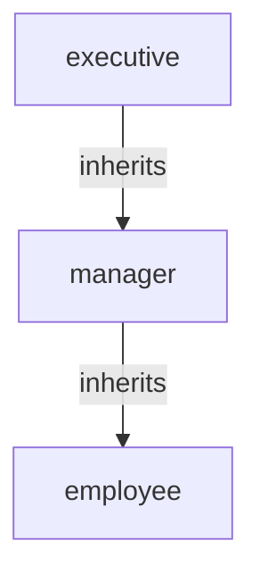
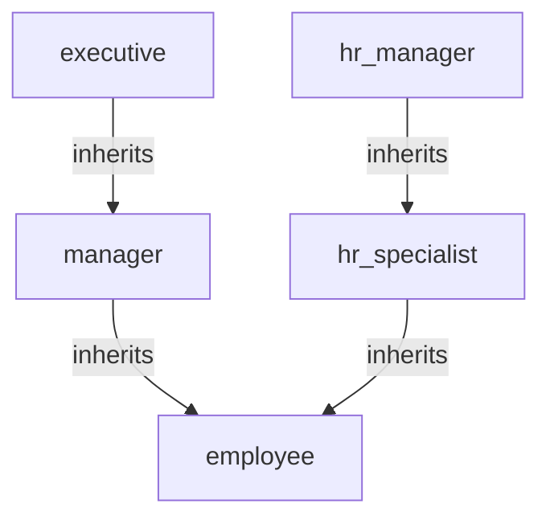

# Modeling patterns: from handbook clauses to SPDL

Use this reference in Phase 2. It maps common policy-document language to Speedle
constructs. The SPDL rules and citations are in
[spdl-and-import.md](spdl-and-import.md); the cost reasoning is in
[evaluation-and-efficiency.md](evaluation-and-efficiency.md).

## 1. Classify the clause first

| Clause language | Model element | Example |
| --- | --- | --- |
| "All employees are in the staff group." | group principal / role assignment | `grant group all_staff role employee` |
| "Managers are also employees." | role inheritance | `grant role manager role employee` |
| "The HR lead approves HR record changes." | role assignment + policy | `grant user alice role hr_manager` |
| "Managers approve expenses up to 5,000." | condition on a numeric attribute | `if amount <= 5000` |
| "Managers approve only their own department." | resource-scoped role or resource prefix | `on expr:^/expenses/engineering/.*$` |
| "HR specialists may read records at their location." | condition on two attributes | `if location == requester_location` |
| "Contractors may not read confidential data." | explicit deny | `deny role contractor read expr:^/data/internal/confidential/.*$` |
| "Payroll sync may update payroll runs." | entity principal | `grant entity payroll_sync read,update expr:^/hr/payroll/.*$` |
| "Exceptions need written approval." | process, not policy | document as out of scope |

Do not turn a process into a condition unless the document gives a machine-checkable rule.
A written-approval process is usually enforced by the PEP or a workflow, not by SPDL.

## 2. Roles

### 2.1 Role or group?

- A **group** is an identity-provider cohort. It arrives in the request as a `group`
  principal. It has no permissions of its own; a role policy can grant it a role.
- A **role** is an authorization concept. It has permissions and can inherit other roles.
- Use a role when the document describes a job function, a responsibility or an approval
  authority. Use a group when it is only a membership source (for example, `all_staff`).
- Do not create both a group and a role with the same name and membership. It doubles the
  assignment surface and makes reviews ambiguous.

### 2.2 Inheritance direction

SPDL writes the child first:

```spdl
grant role manager role employee
```

This means "a manager also has the employee role". In a diagram, draw the arrow from the
child to the parent and label it `inherits`:



Do not reverse the arrow. `grant role employee role manager` would give every employee the
manager role, which is a privilege escalation.

### 2.3 Role scopes

- Global role: `grant user carol role manager`. The role applies to every resource in the
  service. Use it only when the document gives company-wide authority.
- Resource-scoped role: `grant user carol role manager on expr:^/expenses/engineering/.*$`.
  The role exists only while the request resource matches the expression. This is the correct
  way to model "manager of engineering" without a separate permission policy per department.
- A role policy with no `on` is considered for every resource; a role policy with `on` is
  considered only when the request resource matches. The permission policy still has to
  grant the action on the resource.
- Cross-service role: put the assignment in the service named exactly `global`, then use the
  role in each service's policies. Only role policies are global; authorization policies are
  not (`docs/hugo/content/docs/pms/global-policy.md:14-19`).

### 2.4 Role catalog table

Every model should have one:

| Role | Purpose | Assigned to | Scope | Inherits | Source |
| --- | --- | --- | --- | --- | --- |
| `employee` | Base staff access | `group all_staff` | service | — | 3.1 |
| `manager` | Department approvals | scoped user assignments | department | `employee` | 3.5, 6.1 |
| `hr_specialist` | HR record reads | `group hr` | service | `employee` | 3.2, 4.4 |
| `hr_manager` | HR record and salary reads | named users | service | `hr_specialist` | 3.2, 4.5 |

The "Inherits" column must match the Mermaid diagram and the role-policy section exactly.
A mismatch is a modeling defect, not a documentation nit.

## 3. Resources and actions

### 3.1 Resource taxonomy

Choose names for the evaluator, not only for humans:

- Singleton: exact name, for example `/hr/handbook`.
- Family: prefix namespace, for example `/hr/employees/...`, `/hr/salary/...`,
  `/expenses/...`.
- Avoid nesting a sensitive sub-resource under a broad family. `/hr/employees/<id>/salary`
  forces a general regex; `/hr/salary/<id>` is a prefix expression and a separate review
  boundary.
- Use lowercase, slash-separated identifiers. Avoid spaces, commas and parentheses in names;
  if a name needs them, quote it in SPDL.
- Document the identifier construction: who builds the resource string, and whether an
  employee-controlled value can appear in it. Do not let a caller choose a resource string
  that aliases a more sensitive one.

### 3.2 Actions

- Define a small, stable set: `read`, `update`, `create`, `delete`, `approve`, `export`.
- An action is an exact string. `read` does not cover `list`; add both if the document
  distinguishes them.
- Do not encode conditions in action names (`approve_under_5000`). Put the threshold in a
  condition and keep the action name stable.
- Test every action stated in the clause, not only `read`.

### 3.3 Hierarchy

Speedle has no implicit resource hierarchy. If the document says "a manager may act on their
department", either:

1. model a department prefix (`/expenses/engineering/...`) and a scoped role, or
2. supply a `department` attribute from the PEP and use a condition.

Prefer the prefix when the resource string already contains the department: it is indexed
and does not depend on the caller supplying an extra attribute. Prefer the attribute when
the resource identifier does not encode the department or the department changes
independently.

## 4. ABAC conditions

### 4.1 Common attributes

| Attribute | Type | Meaning | Trust |
| --- | --- | --- | --- |
| `owner` | string | owner of the record being read | PEP-derived; must not be caller-controlled |
| `classification` | string | data class: `public`, `internal`, `confidential`, `restricted` | PEP/metadata service |
| `location` | string | location of the record or resource | PEP/metadata service |
| `requester_location` | string | location of the subject | IdP/PEP |
| `amount` | numeric | transaction or expense amount | business system of record |
| `department` | string | department of the resource | PEP/metadata service |

Document who supplies each attribute and why the caller cannot forge it. An attribute that
the caller can set turns an ABAC rule into a suggestion.

### 4.2 Missing attributes

A missing attribute makes the condition non-matching; the policy silently contributes no
grant. This is fail-closed but hard to debug. For each condition:

- list the required attributes in `model.md`;
- add a test case with the attribute present and a test with it absent (or wrong type);
- consider a PEP-side validation that rejects requests missing mandatory attributes, so the
  absence is visible rather than a quiet denial.

### 4.3 Conditions that are usually wrong

- `department == request_resource`: string equality cannot extract a path segment.
- `request_user == owner` on a resource whose owner the caller can choose.
- `request_hour >= 9 && request_hour <= 17` without a time zone; the server clock is local
  to the ADS process. Document the time zone or avoid the rule.
- A condition on a custom function that is not registered in the target store. `spctl check`
  does not catch it; evaluation fails with reason 4.
- A condition that duplicates the resource expression (`request_resource =~ '^/hr/.*$'` when
  the policy already has `expr:^/hr/.*$`). It adds work and no precision.

## 5. Approvals and thresholds

Model an approval chain as one policy per authority, each with a role and a numeric range:

```spdl
grant role manager approve expr:^/expenses/.*$ if amount <= 5000
grant role finance_analyst approve expr:^/expenses/.*$ if amount > 5000 && amount <= 25000
grant role executive approve expr:^/expenses/.*$ if amount > 25000
```

Rules:

- Use the same boundary in the upper and lower condition (`<= 5000` then `> 5000`), so there
  is no gap and no overlap. Test the boundary and one cent over it.
- Do not rely on the absence of a grant to express "not allowed" without documenting it; a
  reader should see the chain in the policy table.
- If the document says "up to and including 5,000", write `<= 5000`; if it says "below
  5,000", write `< 5000`. Do not normalize the wording without the user's confirmation.
- If a person can have two approval roles, their effective authority is the union of the
  grants. Confirm whether the document intends separation of duties; if it does, add a deny
  or split the roles, and test the overlap.
- An approval policy grants the `approve` action; it does not record the approval. The
  application must still enforce the workflow and audit trail.

## 6. Exceptions and explicit denies

Use a deny when the document states an exception to a broader grant:

```spdl
grant role employee read expr:^/data/internal/.*$
deny role contractor read expr:^/data/internal/confidential/.*$
```

- The deny must be narrower than the grant it overrides; otherwise it is a blanket removal.
- An explicit deny is reported with reason 1; a missing grant is reason 3. Test for both;
  they mean different things to an operator.
- Do not use a deny to express "this role has no permission". That is the default. Use a deny
  only when another grant would otherwise allow the request.
- Deny role policies (`deny user x role y`) are supported but interact with inheritance in
  ways that are hard to review. Prefer a deny authorization policy for ordinary exceptions,
  and test any deny role policy against the full inheritance chain.
- Break-glass access is a process, not a broad grant. If the document requires it, model a
  separate role, a short-lived assignment and an audit requirement; do not add `role
  everyone_role` as an emergency path.

## 7. Non-human identities

Use `entity` principals for service accounts, schedulers and integrations:

```spdl
grant entity payroll_sync read,update expr:^/hr/payroll/.*$
```

- Do not give an entity a human role unless the document explicitly says so.
- Keep the entity's resource prefix narrow and its actions minimal.
- Test that a human user with the same resource access cannot use the entity's permissions
  (principals are distinct) and that the entity cannot read unrelated resources.
- If the entity authenticates with a token, the token asserter maps it to the entity
  principal; document that the PEP must not accept a caller-supplied entity name.

## 8. Test design

A test suite is part of the model, not an afterthought. Cover:

| Dimension | Minimum |
| --- | --- |
| Each role | one allow and one deny |
| Each condition | true branch, false branch and missing-attribute branch |
| Each boundary | the boundary value and one unit over |
| Each explicit deny | a denied request with reason 1 |
| Each principal type | user, group, role, entity as applicable |
| Each inheritance chain | the deepest role proving the inherited permission |
| Resource scope | in-scope allow and out-of-scope deny |

Case rules:

- Keep cases deterministic. Do not depend on the wall clock; if a time rule is modeled,
  either inject a test clock (not available in the REST request) or mark the case as
  manually verified and do not claim it in `results.md`.
- Include the expected `reason` when it distinguishes a deny policy (1) from no applicable
  policy (3). Omit it when only the decision matters.
- Use the exact service name from the SPDL.
- Use realistic but synthetic principals and resources. Do not put real employee data in the
  repository.
- Write the description in the document's language; keep IDs stable across revisions.
- One case proves one thing. A case that checks five conditions is hard to diagnose.

The schema is in [../templates/test-cases.json](../templates/test-cases.json). The runner
prints a PASS/FAIL line per case and exits non-zero on any failure.

## 9. Mermaid conventions

Use `flowchart TD` with one node per role. Label inheritance edges with `inherits`; label
assignment edges with `assigned by` if you include them. Do not draw permissions as nodes;
they belong in the policy table. Keep the diagram acyclic and renderable by GitHub.



If a role is scoped, note the scope in the label (`manager (engineering)`) or in the role
catalog; do not draw a separate node for each department unless the document defines
separate roles.

## 10. Review checklist

- The role catalog, Mermaid diagram and `[rolepolicy]` section tell the same story.
- Every role assignment names a principal that the PEP actually sends.
- Every condition attribute is listed with a type and a trust boundary.
- Every policy cites a clause or a confirmed assumption.
- Every `expr:` is exact/prefix/suffix; general regexes are justified.
- Every explicit deny is narrower than the grant it overrides.
- The test suite covers every role, condition branch, boundary, deny and principal type.
- `spctl check` exits 0 and `results.md` records the full run.
