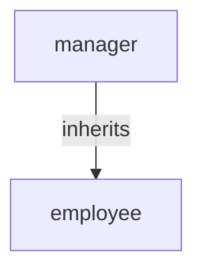

# {{MODEL_NAME}} — Speedle policy model

<!--
Write this document in the language of the source document. Replace every {{PLACEHOLDER}}.
Do not leave guidance comments in the delivered file. Titles do not end with a full stop.
-->

| Field | Value |
| --- | --- |
| Source document | {{SOURCE_DOCUMENT}} |
| Source version / date | {{SOURCE_VERSION}} |
| Service name | `{{SERVICE_NAME}}` |
| Model status | Draft / Reviewed / Approved |
| Generated | {{DATE}} |
| Generated by | {{AUTHOR_OR_SKILL}} |
| SPDL file | `policies.spdl` |
| Tests | `test-cases.json` |
| Validation results | `results.md` |

## 1. Scope

{{One paragraph: what this model covers, which application enforces it, and what is out of
scope. Name the decisions the model does not make, such as approval workflows or physical
access.}}

## 2. Source inventory

| Clause | Requirement (short) | Kind | Disposition |
| --- | --- | --- | --- |
| {{CLAUSE}} | {{TEXT}} | identity / role / authorization / approval / exception / out of scope | {{POLICY_ID or note}} |

<!-- Every clause that affects a decision must map to a policy, a role, an attribute or an
explicit out-of-scope note. A clause with no disposition is an open question. -->

## 3. Organization and identity model

### 3.1 Principals

| Principal | Type | Source | Used for |
| --- | --- | --- | --- |
| {{NAME}} | user / group / entity / role | {{IdP, HR system, assignment}} | {{purpose}} |

### 3.2 Organization facts

| Fact | Value | Source clause |
| --- | --- | --- |
| Departments | {{DEPARTMENTS}} | {{CLAUSE}} |
| Job levels | {{LEVELS}} | {{CLAUSE}} |
| Locations | {{LOCATIONS}} | {{CLAUSE}} |
| Data classes | {{CLASSES}} | {{CLAUSE}} |

## 4. Role model

### 4.1 Role catalog

| Role | Purpose | Assigned to | Scope | Inherits | Source |
| --- | --- | --- | --- | --- | --- |
| `{{ROLE}}` | {{PURPOSE}} | {{PRINCIPAL}} | service / `expr:...` | {{PARENT_ROLE}} | {{CLAUSE}} |

### 4.2 Role inheritance



### 4.3 Role assignment rules

| Rule ID | Principal | Role | Scope | Source clause | SPDL |
| --- | --- | --- | --- | --- | --- |
| R-01 | {{PRINCIPAL}} | `{{ROLE}}` | {{SCOPE}} | {{CLAUSE}} | `{{SPDL_STATEMENT}}` |

## 5. Resource and action model

| Resource / pattern | Kind | Actions | Sensitivity | Source clause |
| --- | --- | --- | --- | --- |
| `{{RESOURCE}}` | exact / prefix / suffix | {{ACTIONS}} | {{CLASS}} | {{CLAUSE}} |

### 5.1 Identifier construction

{{Who builds the resource string, from which values, and why a caller cannot alias a more
sensitive resource. Mention any quoting or regex anchoring.}}

### 5.2 Actions

| Action | Meaning | Notes |
| --- | --- | --- |
| `{{ACTION}}` | {{MEANING}} | {{NOTE}} |

## 6. Attributes and conditions

| Attribute | Type | Supplied by | Trust boundary | Used by |
| --- | --- | --- | --- | --- |
| `{{ATTRIBUTE}}` | string / numeric / bool / datetime / array | {{SOURCE}} | {{TRUST}} | {{POLICY_IDS}} |

### 6.1 Missing attributes

{{For each condition attribute, state what happens when it is missing. Speedle treats a
missing attribute as a non-matching condition, so the policy silently contributes no grant.
Say whether the PEP rejects the request first or the model accepts the silent deny.}}

## 7. Policies

<!-- One subsection per policy. Keep each one reviewable in isolation. -->

### P-01 — {{POLICY_TITLE}}

```spdl
{{SPDL_STATEMENT}}
```

| Field | Value |
| --- | --- |
| Effect | grant / deny |
| Principals | {{PRINCIPALS}} |
| Actions | {{ACTIONS}} |
| Resource | {{RESOURCE}} |
| Condition | {{CONDITION or none}} |
| Required attributes | {{ATTRIBUTES or none}} |
| Implements | {{CLAUSE}} |
| Evaluation index | exact resource / prefix radix / suffix radix / general regex / always |
| Tests | {{CASE_IDS}} |

**Rationale.** {{Why this shape; why a role or a condition; why this resource boundary; what
would break if the policy were broader.}}

## 8. Explicit denies and exceptions

| Deny ID | Statement | Overrides | Why it is narrower | Source clause | Tests |
| --- | --- | --- | --- | --- | --- |
| D-01 | `{{SPDL_STATEMENT}}` | {{GRANT_ID}} | {{NARROWER_REASON}} | {{CLAUSE}} | {{CASE_IDS}} |

{{Explain the deny-over-grant rule and any deny role policies. Mark deny role policies as
high-risk and require tests for the full inheritance chain.}}

## 9. Evaluation-efficiency summary

<!-- Copy the pattern table from the example. State the counts and the index types. -->

| Metric | Value |
| --- | --- |
| Services | {{N}} |
| Authorization policies | {{N}} |
| Role policies | {{N}} |
| Exact-resource policies | {{N}} |
| Prefix/suffix policies | {{N}} |
| General-regex policies | {{N}} |
| Catch-all policies (`expr:^.*$` or `everyone_role`) | {{N}} |

{{Explain how the resource taxonomy keeps hot rules in the hash map or radix trees. Call out
any general regex and why it is justified. See
[../references/evaluation-and-efficiency.md](../references/evaluation-and-efficiency.md).}}

## 10. Test cases

| ID | Clause | Scenario | Request summary | Expected | Reason | Actual |
| --- | --- | --- | --- | --- | --- | --- |
| T-01 | {{CLAUSE}} | {{SCENARIO}} | {{SUBJECT}} → {{ACTION}} {{RESOURCE}} | allow / deny | {{0-4}} | {{PASS/FAIL}} |

{{The full request bodies are in test-cases.json. Include at least one allow and one deny per
role, every condition branch, every boundary, every explicit deny and every principal type.}}

## 11. Clarifications and open questions

### 11.1 Answers applied

| ID | Question | Answer | Decided by | Date |
| --- | --- | --- | --- | --- |
| Q-01 | {{QUESTION}} | {{ANSWER}} | {{PERSON}} | {{DATE}} |

### 11.2 Open questions

| ID | Question | Why it matters | Status |
| --- | --- | --- | --- |
| O-01 | {{QUESTION}} | {{IMPACT}} | open / blocked / accepted risk |

{{Do not encode a policy for an open question. If the user accepts a risk, record it here.}}

## 12. Import and operation

```bash
# Validate SPDL and conditions without a server
spctl check -f policies.spdl

# Load the same file into a local PMS and ADS and run every test case
scripts/validate-model.sh policies.spdl test-cases.json
```

{{State the target store type. If it is the `.spdl` file store, repeat that it is read-only:
PMS rewrites the file as JSON on a management write, so change the SPDL and restart/reload.
If the target is JSON, etcd, MySQL or MongoDB, give the store-specific deployment steps.}}

## 13. Change log

| Date | Change | Author |
| --- | --- | --- |
| {{DATE}} | Initial model | {{AUTHOR}} |
